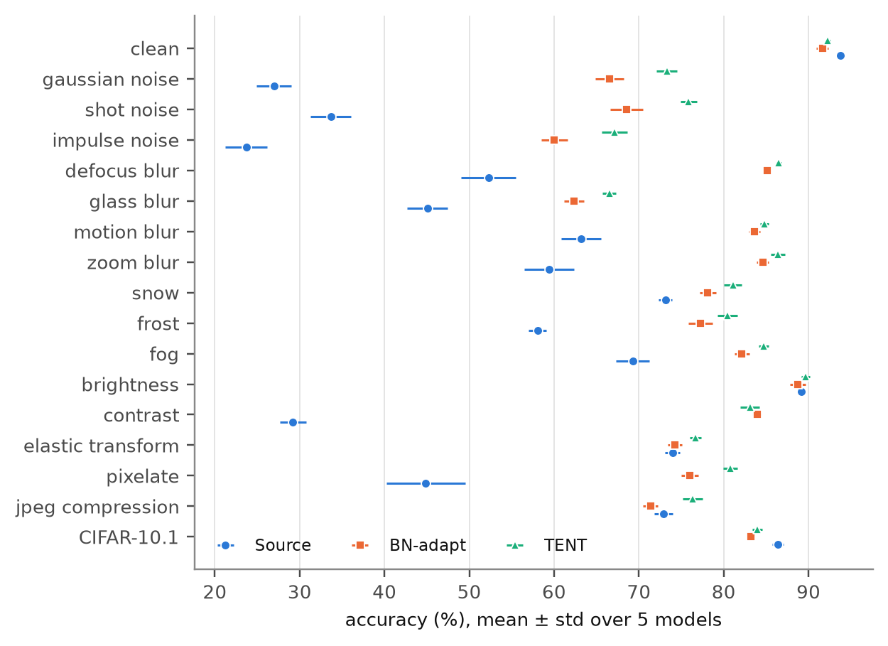
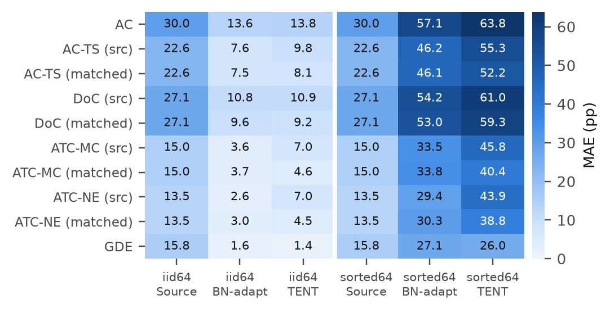
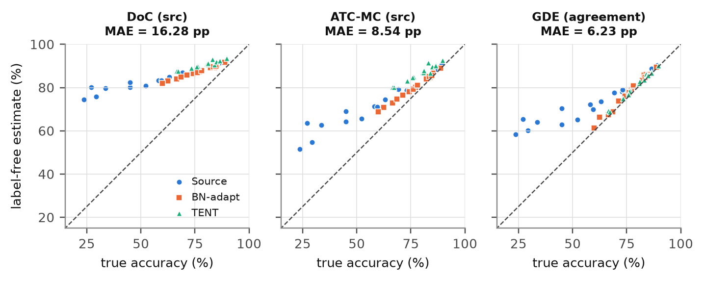
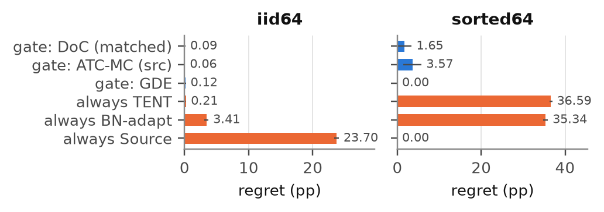

# Can We Trust the Adapted Model Without Labels?

**Validity of Label-Free Accuracy Estimators after Test-Time Adaptation and an Adapt-or-Not Gate**

Ozal Omarli — Advisor: Asst. Prof. Ramin Abbaszadi — OSTİM Technical University, Deep Learning Final Project

---

## Overview

This repository contains the code, preregistration and results of a study on how well the accuracy of a model can be estimated without labels after test-time adaptation (TTA). Five independent CIFAR ResNet-18 models were run with Source, BN-adapt and TENT on clean CIFAR-10, 15 CIFAR-10-C corruptions (severity 5) and CIFAR-10.1, under i.i.d. and label-sorted streams. The errors of the AC, AC-TS, DoC, ATC-MC, ATC-NE and GDE estimators were then measured with preregistered hypothesis tests, and a label-free "adapt / do not adapt" gate was evaluated.

## Results at a glance

All numbers: 5 independent ResNet-18 models (mean ± std), 16 shifted domains (15 CIFAR-10-C corruptions + CIFAR-10.1), test batches of 64 samples. **iid64** = shuffled test stream, **sorted64** = label-sorted test stream.

### 1. Test-time adaptation works on i.i.d. streams



On the i.i.d. stream, TENT raises accuracy on all 15 corruptions; mean shifted accuracy goes from **56.3%** (Source) to **76.6%** (BN-adapt) and **79.8%** (TENT). On the label-sorted stream, the same methods collapse to **21.0%** and **19.7%**.

### 2. How wrong are label-free accuracy estimates?



Mean absolute error (percentage points) of each label-free accuracy estimator. After i.i.d. adaptation, agreement between independent models (**GDE**) is the most accurate estimator (**1.4–1.6 pp**). On label-sorted streams, every estimator is off by **26–64 pp** for the adapted models.

### 3. Estimates vs. true accuracy



Domain-level estimates on the i.i.d. stream (5-model average). The dashed line is a perfect estimate; points above it mean the estimator overestimates accuracy.

### 4. A label-free "adapt or not" gate



Regret relative to an oracle that always picks the best option (lower is better). Label-free gates stay within **0–3.6 pp** of the oracle in both conditions, while every fixed choice loses up to **23.7 pp** (always Source) or **36.6 pp** (always TENT) in one of them.

Full result table and hypothesis decisions: [`Final/README.md`](Final/README.md).

## Repository structure

```
Final/                  main project (ttamon package)
  ttamon/               data, models, methods, estimators, metrics, statistics, thermal guard
  scripts/              training, prediction collection, analysis, figures, audit checks
  tests/                pytest unit tests
  results/              all_runs.csv, summary.json, tables/, logs/   (raw logits: see Releases)
  figures/              analysis figures
  thermal/              notes on the thermal guard
  PREREGISTRATION.md    preregistered hypotheses and deviations
src/, scripts/, tests/  original (audited) code base, used by Final/scripts/verify_audit.py
results/                logs of the original code base (incl. training curves for seeds 42–44)
AUDIT.md                audit findings for the original code base
assets/figures/         the English result figures shown in this README
data/                   datasets (not in the repository; see data/README.md)
```

## Large files (GitHub Releases)

Model weights and raw logits are not stored in the repository. They are attached to the **Releases** page (`v1.0`):

| File | Where to put it |
|---|---|
| `resnet18_cifar10_seed42.pth` … `seed46.pth` | `src/models/checkpoints/` |
| `raw_logits.zip` | extract into `Final/results/` (→ `Final/results/raw/`) |
| `SHA256SUMS.txt` | to verify the downloaded files |

The checkpoint SHA256 values match `Final/results/logs/checkpoint_hashes_final.json`.

## Installation

```powershell
uv venv .venv --python 3.12
uv pip install --python .venv\Scripts\python.exe -r Final\requirements.txt --index-url https://download.pytorch.org/whl/cu128 --extra-index-url https://pypi.org/simple
cd Final
..\.venv\Scripts\python.exe -m pytest -q
```

## Reproduction

* **Tables and figures only** (no GPU or retraining needed): download the datasets as described in `data/README.md` (labels are read from them), extract `raw_logits.zip` into `Final/results/`, then run `python scripts/analyze.py` and `python scripts/make_figures.py` inside `Final/`.
* **Full pipeline:** download the datasets as described in `data/README.md`, place the checkpoints, and run `Final/run_all.ps1` (Windows) or `Final/run_all.sh`.

All reported numbers are generated automatically into `Final/results/summary.json` and `Final/results/tables/`. Seeds, environment and hardware details are in `Final/README.md`.

## Data note

The CIFAR-10, CIFAR-10-C and CIFAR-10.1 datasets are not included in this repository and are subject to the terms of their original sources.
